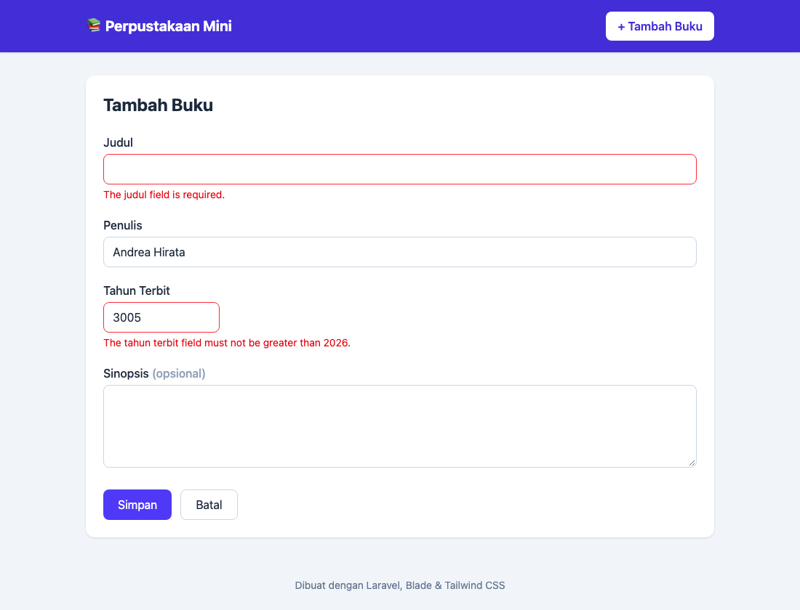
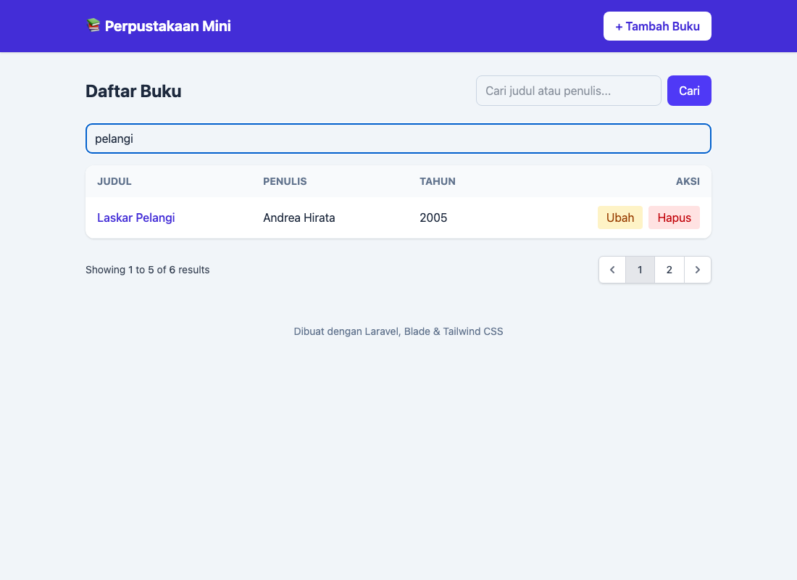

# Perpustakaan Mini — Daftar Buku

Aplikasi web sederhana untuk mengelola data buku, dibuat dengan **Laravel**, **Blade**, dan **Tailwind CSS** mengikuti tutorial *Membangun Website Daftar Buku*.

## Fitur

- Tambah, lihat detail, ubah, dan hapus data buku (CRUD)
- Validasi form dengan pesan error di bawah setiap isian
- Pencarian berdasarkan judul atau penulis
- Pagination 5 buku per halaman
- Data contoh lewat seeder
- Interaktivitas JavaScript: konfirmasi hapus, penghitung karakter sinopsis, validasi di sisi klien, dan saring cepat tabel

## Teknologi

| Bagian | Yang dipakai |
| --- | --- |
| Backend | Laravel 13 (PHP 8.3+) |
| Tampilan | Blade + Tailwind CSS 4 |
| Build aset | Vite |
| Database | SQLite |

## Cara Menjalankan

Prasyarat: PHP 8.3+, Composer, dan Node.js.

```bash
git clone https://github.com/isyraqawwaluthorid/perpustakaan-mini.git
cd perpustakaan-mini

composer install
npm install

cp .env.example .env
php artisan key:generate

php -r "file_exists('database/database.sqlite') || touch('database/database.sqlite');"
php artisan migrate --seed
composer run dev
```

Lalu buka **http://127.0.0.1:8000**.

> Di Windows (Command Prompt), ganti `cp` dengan `copy`.

## File yang Dibuat

| File | Isi |
| --- | --- |
| `database/migrations/…_create_bukus_table.php` | Struktur tabel `buku` |
| `app/Models/Buku.php` | Model Buku |
| `app/Http/Controllers/BukuController.php` | Logika CRUD dan pencarian |
| `routes/web.php` | Daftar alamat URL |
| `resources/views/layouts/app.blade.php` | Kerangka halaman (menu, pesan, footer) |
| `resources/views/buku/index.blade.php` | Halaman daftar buku |
| `resources/views/buku/_form.blade.php` | Isian form yang dipakai bersama |
| `resources/views/buku/create.blade.php`, `edit.blade.php`, `show.blade.php` | Halaman tambah, ubah, dan detail |
| `database/seeders/BukuSeeder.php` | Data contoh |
| `resources/js/app.js` | Fitur JavaScript (dimuat lewat `@vite` di layout) |

## Interaktivitas JavaScript

Semua kode ada di `resources/js/app.js` dan berjalan setelah `DOMContentLoaded`.

| No | Fitur | Cara kerja | Elemen di Blade |
| --- | --- | --- | --- |
| 1 | Konfirmasi hapus | `submit` pada form hapus memanggil `confirm()`; jika dibatalkan, `preventDefault()` | `<form data-confirm="Yakin hapus buku ini?">` di `index.blade.php` |
| 2 | Penghitung karakter | Event `input` pada sinopsis memperbarui teks "N karakter" | `<p id="penghitung-sinopsis">` di `_form.blade.php` |
| 3 | Validasi di sisi klien | Sebelum form dikirim, judul dan penulis dicek tidak kosong, tahun dicek 1000 sampai tahun ini. Pesan dibuat dengan `createElement`, garis input diganti lewat `classList` | `<form id="form-buku">` di `create` dan `edit` |
| 4 | Saring cepat | Event `input` menyembunyikan baris tabel (`hidden`) yang tidak memuat kata kunci, tanpa memuat ulang halaman | `<input id="filter-cepat">` dan `<tr data-buku>` di `index.blade.php` |

Validasi klien hanya mempercepat umpan balik. Validasi di server (`$request->validate()` di `BukuController`) tetap wajib, karena JavaScript bisa dimatikan atau request bisa dikirim langsung tanpa browser.

Saring cepat hanya menyaring 5 baris di halaman yang sedang tampil. Untuk mencari ke seluruh data, gunakan kotak **Cari** (pencarian di server).

> Catatan: di Tailwind CSS 4, class `border-slate-300` ditulis setelah `border-red-500` di file CSS, sehingga menambah `border-red-500` saja tidak mengubah warna garis. Karena itu validasi klien juga melepas `border-slate-300` saat isian salah.

| Validasi klien | Validasi server (JavaScript dimatikan) |
| --- | --- |
|  |  |



## Hasil Uji

Diuji pada 22 November 2026 di Chromium dengan data dari `BukuSeeder` (6 buku).

| No | Skenario | Hasil yang diharapkan | Hasil aktual | Status |
| --- | --- | --- | --- | --- |
| 1 | Buka halaman daftar buku | Tampil 5 buku dan tombol halaman 2 | 5 buku tampil, tombol halaman 2 ada | Lulus |
| 2 | Ketik "Ahmad" di kotak Cari lalu klik Cari | Hanya buku Ahmad Tohari dan Ahmad Fuadi | Tampil Negeri 5 Menara (Ahmad Fuadi) dan Ronggeng Dukuh Paruk (Ahmad Tohari) | Lulus |
| 3 | Ketik "pelangi" di kotak Saring di halaman ini | Baris tersaring seketika tanpa memuat ulang halaman | Hanya Laskar Pelangi yang tampil, tidak ada request ke server | Lulus |
| 4 | Ketik "ahmad" di Saring, lalu kosongkan | Hanya baris di halaman ini yang tersaring; saat dikosongkan semua baris kembali | 2 baris tampil, lalu 5 baris kembali | Lulus |
| 5 | Tambah Buku: kosongkan judul, isi tahun 3005, klik Simpan | Pesan merah muncul tanpa halaman dimuat ulang | Muncul "Judul wajib diisi." dan "Tahun harus antara 1000 dan 2026.", garis input merah, tidak ada request ke server | Lulus |
| 6 | Ketik "Halo dunia" di Sinopsis | Jumlah karakter bertambah langsung | Tertulis "10 karakter" | Lulus |
| 7 | Isi form dengan benar lalu Simpan | Pesan hijau "Buku berhasil ditambahkan." | Pesan hijau muncul, buku baru ada di daftar | Lulus |
| 8 | Klik judul buku, klik Ubah, ganti judul, Simpan Perubahan | Detail tampil, penghitung terisi, pesan "Buku berhasil diperbarui." | Detail tampil, penghitung "25 karakter" saat form dibuka, pesan muncul, judul berubah | Lulus |
| 9 | Klik Hapus lalu pilih Cancel | Muncul "Yakin hapus buku ini?", buku tidak terhapus | Dialog muncul, buku tetap ada | Lulus |
| 10 | Klik Hapus lalu pilih OK | Buku hilang dari daftar | Pesan "Buku berhasil dihapus.", buku hilang | Lulus |
| 11 | Matikan JavaScript, ulangi skenario 5 | Pesan error tetap muncul dari server, isian penulis tidak hilang | "The judul field is required." dan "The tahun terbit field must not be greater than 2026.", penulis tetap terisi | Lulus |

